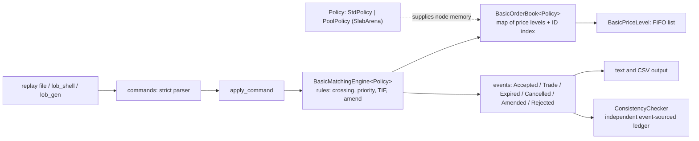
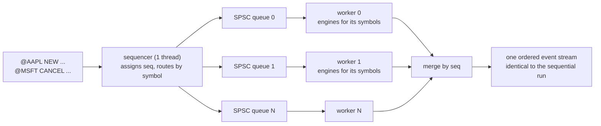
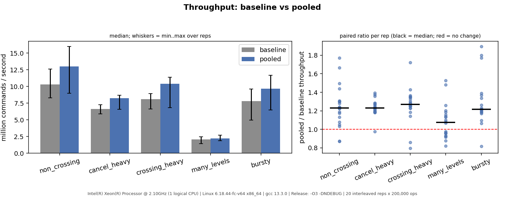

# Limit Order Book & Matching Engine (C++20)

A deterministic limit order book and matching engine for one or many instruments, built as a portfolio project:
**correctness first, then honest measurement, then one evidence-driven optimisation.**

It accepts limit and market orders (GTC / IOC / FOK), cancels and amends, matches by price-time priority,
emits an auditable event stream, replays input files deterministically, and verifies itself with an
independent checker. Two interchangeable implementations ship: a simple baseline and an arena-allocated
one whose gain (and cost) is measured, not assumed. Phase 7 adds multiple instruments and a sharded,
lock-free concurrent pipeline whose output is verified byte-identical to the sequential run. Phase 8 adds a
checksummed write-ahead log and crash recovery, tested against truncation at every byte and corruption at every bit.

> Independent portfolio project. Not an exchange, not production code, and it makes no claim of
> exchange-grade latency. Benchmark numbers come from a noisy shared VM; see [Results](#results-and-how-to-read-them).

## Quick start
```bash
git clone https://github.com/DevPatel433/limit-order-book.git && cd limit-order-book
scripts/quickstart.sh          # build (Release), test, replay samples, run a generated workload, benchmark smoke
```
Needs a C++20 compiler and CMake >= 3.21 (GoogleTest is fetched on first build). The same steps by hand:
```bash
cmake -S . -B build -DCMAKE_BUILD_TYPE=Release && cmake --build build -j
ctest --test-dir build --output-on-failure                       # unit, property, golden, regression, CLI, bench smoke
./build/lob_replay data/sample/orders.txt --check                # replay + verify every command
./build/lob_replay data/sample/orders.txt --csv > events.csv     # CSV event log
./build/lob_shell                                                # interactive terminal view
./build/lob_mreplay data/sample/multi.txt --check                # multi-instrument replay (Phase 7)
./build/lob_mgen --seed 1 --count 200000 --symbols 16 > m.txt && ./build/lob_mreplay m.txt --threads 4 --verify --quiet
./build/lob_mreplay m.txt --quiet --wal run.wal && ./build/lob_recover run.wal      # write-ahead log, then recover (Phase 8)
scripts/run_benchmarks.sh bench_out --pin-cpu 2                  # both engines, interleaved, plots
```
Presets: `cmake --preset release|debug|asan|tsan|profile` (`asan` = Debug + ASan/UBSan + `-Werror`; `tsan` = ThreadSanitizer).

## Demo
`data/sample/demo.txt`:
```
NEW 1 SELL 101 5
NEW 2 SELL 102 10
NEW 3 BUY 99 8
NEW 4 BUY MKT 7                 # market order: sweeps both asks
NEW 5 BUY 102 20 FOK            # fill-or-kill: only 8 available, so nothing trades
AMEND 3 100 8                   # price change: loses queue position
```
`./build/lob_replay data/sample/demo.txt` prints, verbatim (a test fails if this block ever drifts from the real output):
```
ACCEPTED id=1 Sell 101 x 5
ACCEPTED id=2 Sell 102 x 10
ACCEPTED id=3 Buy 99 x 8
ACCEPTED id=4 Buy MKT x 7 IOC
TRADE maker=1 taker=4 Buy 101 x 5            <- trades execute at the resting order's price
TRADE maker=2 taker=4 Buy 102 x 2
ACCEPTED id=5 Buy 102 x 20 FOK
EXPIRED id=5 remaining=20                    <- killed whole: the book is untouched
AMENDED id=3 99 x 8 -> 100 x 8 priority=lost
BOOK depth=5
  ASK 102 x 8 (1)
  ----
  BID 100 x 8 (1)
END
SUMMARY commands=6 accepted=5 rejected=0 trades=2 cancelled=0 traded_qty=7 resting=2 expired=1 amended=1
```

## Architecture

| Component | Responsibility |
|---|---|
| `OrderBook` | bid/ask price levels (`std::map`), per-level FIFO (`std::list`), ID index (`unordered_map`) for O(1) cancel; stores, never matches |
| `MatchingEngine` | all rules: crossing, price-time priority, trade at maker price, IOC/FOK/market, amend; emits events |
| `Policy` | where node memory comes from: baseline `std::allocator` or a per-book arena; logic is shared, so behaviour is identical |
| `commands` / `replay` / `apply` | strict text format, deterministic runner, CSV, shared by the CLI and shell |
| `ConsistencyChecker` | rebuilds the book from events only and checks every rule; shares no matching logic with the engine |
| `benchmarks/` | workload generator, statistics, allocation counter, runner |

### Phase 7: instruments and threads

Each symbol lives on one shard and is matched by the unchanged single-threaded engine, so per-book order is
preserved and the merged output equals the sequential output for any shard count and any thread timing.
**No speedup is claimed:** the development machine had one CPU; what is measured is overhead (8-18%) and the
partition bound ([results_phase7.md](docs/results_phase7.md), [phase7_design.md](docs/phase7_design.md)).

### Phase 8: durability
Every command is appended to a checksummed log **before** it can change a book (`journal` hook on the sequencer, or
`DurableMultiEngine`); after a crash `lob_recover` replays the log through the same deterministic engine.
A torn last record (a crash mid-write) is discarded; damage anywhere earlier is reported, never silently dropped
([wal_format.md](docs/wal_format.md), [phase8_design.md](docs/phase8_design.md)). Measured on the dev VM: logging costs about 2x
without `fsync`, about 1000x with `fsync` per record (storage-specific), recovery runs at about 2.2 M commands/s
([results_phase8.md](docs/results_phase8.md)).

## Key design decisions and trade-offs
* **Integer tick prices, `uint64` quantities**, explicit overflow guards: no floating-point keys, exact comparisons.
* **`std::map` + `std::list` + `std::unordered_map` first.** Simple and clearly correct; replaced only with
  profile evidence. Cost: one heap node per order per container and pointer chasing.
* **One matching path.** Market = "IOC/FOK with no limit"; `amend` re-enters through the same routine.
* **Amend keeps time priority only if the price is unchanged and the quantity does not increase.**
* **Events are the contract.** Replaying them reconstructs the book (the checker does exactly that).
* **Baseline kept selectable.** The pooled engine is faster on most workloads but never returns memory and
  hides nodes from sanitizers; so both ship and every test runs on both.
* **The matching core is single-threaded and deterministic** by design; same input, same output, on both implementations.
  Concurrency (Phase 7) is *around* it: one book per symbol, sharded across threads, never a shared book.

More: [phase5_design.md](docs/phase5_design.md) (optimisation + trade-offs), [phase6_design.md](docs/phase6_design.md)
(order types, verification, cost), [matching_rules.md](docs/matching_rules.md) (the specification),
[order_lifecycle.md](docs/order_lifecycle.md) (state diagram and event sequences).

## Testing and verification
**336 tests** (unit, typed over both engines, property, golden, regression, CLI, benchmark smoke), also run under ASan/UBSan, and the threaded ones under ThreadSanitizer.
* Hand-written examples for every rule, run against both engines.
* **Two naive reference engines** (flat vector, linear scans, no shared code) compared **event-for-event**
  on thousands of random sequences.
* **Independent checker** run after every command on seeded random workloads (including crossing-heavy,
  cancel-heavy, malformed-input and every-order-type profiles); plus a global conservation law
  `accepted + amend_added = 2 x traded + cancelled + expired + resting + amend_removed`.
* Hand-traced golden files and a regression directory with a defined workflow (property failures print a
  reproduction command).
* **Mutation testing** of the checker: injected engine bugs must be detected. It found a real gap (shared
  helper) that is now fixed ([phase6_design.md](docs/phase6_design.md)).
* **Pipeline verified by differential testing** against the sequential run (1-16 shards, both engines, tiny queues, skew),
  by TSan, and by **mutation tests** of the pipeline (10 injected bugs; one, a weakened memory ordering, is invisible
  without TSan).
* **Recovery verified by property tests**: truncating the log at every byte offset always recovers exactly a prefix of the
  commands; flipping every bit is detected (except inside the final record, which is indistinguishable from a torn write); a
  scanner fuzzer runs under ASan/UBSan; 12 injected WAL bugs were all caught.
* The project's own defect log, including mistakes in its analysis, is in [milestones.md](docs/milestones.md).

## Results and how to read them
Methodology ([benchmarking.md](docs/benchmarking.md)): operations are pre-generated; separate throughput,
latency and allocation passes on fresh engines; warm-up excluded; percentiles reported only when the sample
size supports them; clock overhead reported; environment recorded in every CSV row; Debug builds refused;
engine comparisons use interleaved, paired runs with a sign test, and an A/A control where wall-clock is
close.

| Phase 5: pooled vs baseline (paired, 20 interleaved reps) | throughput ratio | verdict |
|---|---:|---|
| non_crossing | 1.23x | faster |
| cancel_heavy | 1.23x | faster |
| crossing_heavy | 1.27x | faster |
| bursty | 1.22x | faster |
| many_levels | 1.08x | inconclusive |



Why: instructions per command fell 31-46% (allocator share 30-51% -> 0-5%). Why not more / why
`many_levels` does not gain: it is cache-miss bound. What it costs: memory is not returned until the book is
destroyed, and bursty flow used 26% more heap. The Phase 6 order types cost +1.5% to +3.8% instructions per command.
Full tables, figures and caveats: [results_phase5.md](docs/results_phase5.md), [results_baseline.md](docs/results_baseline.md).

**Read these as relative results on one noisy machine** (shared single-vCPU VM, no pinning, no hardware
counters). Absolute latencies are not portable claims. Re-run `scripts/run_benchmarks.sh` on your hardware.

## Limitations
No checkpoints (recovery replays the whole log), no group commit, no replication; no measured multi-core speedup (one-CPU dev machine); one hot symbol caps parallelism; threaded output is merged after the
fact and skips mid-stream SNAPSHOTs; no self-trade prevention, post-only/stop/iceberg orders, auctions,
networking, checkpoints or log rotation; synthetic uniform-random benchmark flow; unfixed rehash latency spikes in the ID index; pooled
memory is sticky. Limits and the complexity table are in
[limitations.md](docs/limitations.md).

## Repository layout
```
include/lob/   types, Order, PriceLevel, OrderBook, events, MatchingEngine, policy + arena,
               commands (parser), replay, checker, generator,
               multi (symbols, router, @SYMBOL parser), spsc_queue, pipeline, multi_replay, multi_generator, wal
src/           library implementation
apps/          lob_replay, lob_gen, lob_shell, lob_mreplay, lob_mgen, lob_recover
benchmarks/    lob_bench, lob_scale, lob_wal, lob_spikes, workloads, statistics, allocation counter
scripts/       quickstart, run_benchmarks, profile, plot_results, compare_engines, compare_builds, summarize_callgrind
tests/         unit, typed (both engines), model-based, property, golden, regression
data/sample/   hand-traced replay files with golden output
docs/          rules, lifecycle, format, benchmarking, results, design notes, limitations, interview notes
```

## Documentation index
[matching_rules](docs/matching_rules.md) | [order_lifecycle](docs/order_lifecycle.md) | [replay_format](docs/replay_format.md) |
[design](docs/design.md) | [benchmarking](docs/benchmarking.md) | [results_baseline](docs/results_baseline.md) |
[phase5_design](docs/phase5_design.md) | [results_phase5](docs/results_phase5.md) | [phase6_design](docs/phase6_design.md) |
[phase7_design](docs/phase7_design.md) | [results_phase7](docs/results_phase7.md) |
[phase8_design](docs/phase8_design.md) | [wal_format](docs/wal_format.md) | [results_phase8](docs/results_phase8.md) |
[limitations](docs/limitations.md) | [interview_notes](docs/interview_notes.md) | [milestones](docs/milestones.md) | [CHANGELOG](CHANGELOG.md)

## License and report
MIT, see [LICENSE](LICENSE). The full write-up is [docs/Project_Report.pdf](docs/Project_Report.pdf).

## Roadmap
All phases 0-8 complete; see [milestones.md](docs/milestones.md). Natural next steps: checkpoints plus log truncation and group commit, run `lob_scale` on a multi-core
machine, streaming output with a sequence watermark, load-aware sharding, an intrusive order pool, hardware-counter
profiling, a realistic order-flow model.
