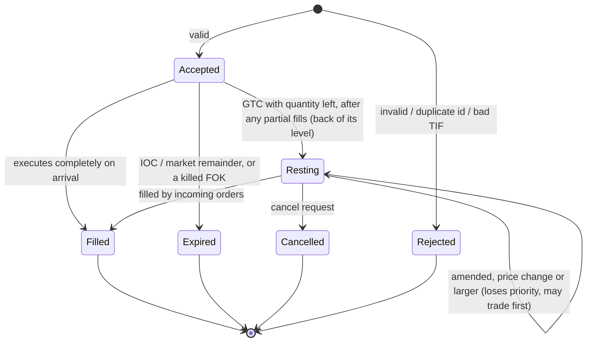

# Order lifecycle

Every state change is an event; replaying the events reconstructs the book (the consistency
checker does exactly that). Mermaid diagrams render on GitHub.

## States of an order

"Filled", "Expired" and "Cancelled" orders leave the book and their IDs become reusable.

## What a client sees (event sequences)
| Situation | Events, in order |
|---|---|
| GTC limit, does not cross | `Accepted` |
| GTC limit, crosses, fully filled | `Accepted`, `Trade`... |
| GTC limit, crosses, partly filled | `Accepted`, `Trade`..., (remainder rests: no event) |
| IOC / market, fully filled | `Accepted`, `Trade`... |
| IOC / market, partly or not filled | `Accepted`, `Trade`..., `Expired{remaining}` |
| FOK, fully fillable | `Accepted`, `Trade`... |
| FOK, not fully fillable | `Accepted`, `Expired{quantity}` (nothing traded, book untouched) |
| cancel of a live order | `Cancelled{remaining}` |
| amend, same price, not larger | `Amended{keeps_priority=true}` |
| amend, price change or larger | `Amended{keeps_priority=false}`, then `Trade`... if it now crosses |
| anything invalid | a single `Rejected{reason}` |

## Life of one order, traced
`data/sample/orders.txt` (hand-verified; golden output in `orders.expected`):
```
NEW 5 BUY 90 4            ACCEPTED id=5 Buy 90 x 4              rests behind order 4
AMEND 5 90 9              AMENDED id=5 90 x 4 -> 90 x 9 priority=lost    grew: moved to the back
NEW 10 SELL 90 5          TRADE maker=4 taker=10 Sell 90 x 3     order 4 (still first) trades first
                          TRADE maker=5 taker=10 Sell 90 x 2     then order 5; 7 left open
AMEND 5 95 7              AMENDED id=5 90 x 7 -> 95 x 7 priority=lost    new price level, back of queue
```

## Where each transition is implemented
| Transition | Code |
|---|---|
| validation | `OrderBook::precheck` |
| accept / cross / dispose | `MatchingEngine::submit`, `match_and_dispose` |
| FOK availability | `OrderBook::fillable_quantity` |
| maker fill | `OrderBook::execute_front` |
| cancel | `MatchingEngine::cancel` -> `OrderBook::cancel` |
| amend | `MatchingEngine::amend` (+ `OrderBook::reduce_quantity` for the in-place case) |
