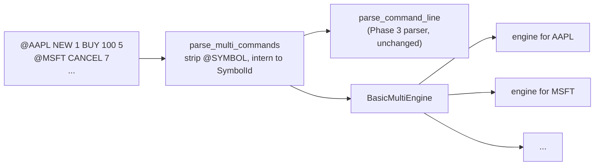

# Phase 7 — multiple instruments and concurrent input

Phase 6 ended with two items deliberately left undone: *multiple instruments* and *concurrency*
([limitations.md](limitations.md)). They are also the last of the roadmap's interview prompts ("what changes
would be needed for multiple instruments or concurrent input?"). Phase 7 builds both, **without touching the
matching core**: `BasicMatchingEngine`, `BasicOrderBook` and the checker are unchanged. Everything new is a
layer around them.

Roadmap discipline still applies: semantics first, then a differential oracle, then performance claims. The
oracle for this phase is the sequential run: the concurrent pipeline is correct **iff** its output equals it.

## What was added

| Piece | Where | Role |
|---|---|---|
| `SymbolTable`, `SymbolCommand`, `SymbolEvent` | `include/lob/multi.hpp` | names to dense ids; commands and events tagged with an instrument |
| `BasicMultiEngine<Policy>` | `multi.hpp` | router: one independent engine per symbol, created on first use |
| `@SYMBOL` format | `src/multi.cpp` | strict multi-instrument text format; delegates the rest of each line to the Phase 3 parser |
| `SpscQueue<T>` | `include/lob/spsc_queue.hpp` | bounded lock-free single-producer/single-consumer ring buffer |
| `BasicShardedPipeline<Policy>` | `include/lob/pipeline.hpp`, `src/pipeline.cpp` | sequencer + one worker thread per shard + deterministic merge |
| `run_sequential` | `pipeline.cpp` | the single-threaded reference the pipeline is verified against |
| `generate_multi` | `include/lob/multi_generator.hpp` | seeded multi-symbol workload with optional hot-symbol skew |
| `multi_replay` and `lob_mreplay`, `lob_mgen` | `src/multi_replay.cpp`, `apps/` | CLI: sequential with per-symbol checker, threaded, `--verify`, CSV |
| `lob_scale` | `benchmarks/scaling_bench.cpp` | scaling benchmark with a correctness gate on every run |

Two small refactors exposed existing code instead of duplicating it: `parse_command_line` (the single
definition of the one-book line syntax) and `tally_event` / `merge_stats` (so every runner counts alike).

## Instruments



**Order IDs are scoped per symbol.** "Order 1" in AAPL and "order 1" in MSFT are unrelated, so a cancel or
amend must name its symbol. Reasons: (1) the engine already keys everything by ID *within one book*, so no
cross-book coordination or shared index is needed; (2) it is what lets books live on different threads with no
shared state. The alternative, venue-wide unique IDs (common on real exchanges), would let a cancel omit the
symbol but needs a global `ID -> symbol` index that every shard must consult or that must itself be sharded by
ID. That is a different design (and a different bottleneck), recorded here rather than built.

**Format.** `@<SYMBOL> <any single-book command>`. Symbols are 1-16 characters from `A-Z a-z 0-9 _ . -`,
case-sensitive. A line without a prefix is an **error** unless the caller supplies a default symbol
(`--default-symbol`), so a forgotten prefix can never silently route an order to the wrong book. Everything after
the prefix goes through the same parser as a single-book file, so the two formats cannot drift. Symbols are
numbered by first appearance, which makes ids (and the order of final books and summaries) deterministic.
At most 65,536 symbols, so a corrupt file gets a defined error instead of a huge allocation.

**Isolation is tested as a property**, not assumed: for random workloads with every order type, the
lines printed for one symbol equal what the Phase 1-6 single-book `replay()` prints for just that symbol's
commands; removing all other symbols' traffic does not change a symbol's events; and a one-symbol pipeline
reproduces the old engine's output exactly.

## Concurrency

```
 producer (the sequencer)             one SPSC queue per shard         one worker thread per shard
 ------------------------             ------------------------         ---------------------------
 assigns seq = 1, 2, 3, ...  ------>  [queue 0] ----------------->    worker 0: engines of shard 0
 routes by symbol % shards   ------>  [queue 1] ----------------->    worker 1: engines of shard 1
                                      [queue N] ----------------->    worker N: ...
 after join(): k-way merge of the workers' event buffers by seq  ->  one ordered event stream
```

### The determinism argument
1. A symbol maps to exactly one shard (`symbol_id % shards`), and a queue is FIFO, so each book receives its
   commands one at a time **in input order**, exactly as in the sequential run.
2. The engine is a deterministic function of its command sequence, and workers share no mutable state, so
   each symbol's events are identical to the sequential run's regardless of thread timing.
3. Each command goes to one shard and carries its input sequence number; one command's events are contiguous.
   Merging by that number therefore reproduces the sequential global order.

Hence the merged output is **byte-identical to `run_sequential` for any shard count and any scheduling**.
This is checked, not just argued (see Verification). Throughput changes with threads; output must not.

### Decisions and trade-offs
* **SPSC, not MPMC.** There is one producer by construction: the sequencer is also what defines the total input
  order. One queue per shard keeps every queue single-producer/single-consumer, which is the cheapest
  correct structure (no CAS loop, no contention on a shared head/tail). The price: the producer is a serial
  stage (Amdahl), and the design cannot accept input from several threads without adding a sequencer.
* **Queue details** (`spsc_queue.hpp`): capacity a power of two with monotonically increasing indices (full
  vs empty by subtraction, no wasted slot); the producer writes the slot then *release*-stores `tail`, the
  consumer *acquire*-loads it (and the mirror pair for `head`); each side caches the other's index and re-reads
  the shared atomic only when the cache says full/empty; the four hot fields sit on separate cache lines; the
  queue message (`WorkItem`) is padded to a cache line so adjacent slots are not shared. I have **not**
  measured the effect of each of those choices; they are standard practice, not a result of this project.
* **Static symbol-to-shard map.** Simple, deterministic, and free of coordination, but blind to load: one hot
  symbol makes its shard the bottleneck whatever the shard count. `lob_scale` reports the **partition bound**
  (`1 / largest shard share`), the best speedup the split allows, so skew is visible instead of hidden. Fixes
  (weighted assignment, hashing names, splitting a hot symbol's work) are not built. A single book cannot be
  split without breaking price-time priority, so one symbol is the unit of parallelism.
* **Offline merge, not a streaming output queue.** Workers buffer their events and `finish()` merges after
  `join()`. That makes ordering trivially correct and keeps workers contention-free, but output is not
  available until the end, memory grows with the event count, and the merge is single-threaded. A streaming
  design (per-shard output SPSC queues into a merger that releases events up to the minimum
  "completed sequence number" across shards) would fix all three; it is the obvious next step and is not built.
  `collect_events = false` exists so the matching cost can be measured without this stage.
* **Backpressure.** A full queue blocks the producer; an empty queue makes a worker wait. Both ends use one
  escalation policy: retry, then `yield()`, then 50 microsecond sleeps. That is friendly to machines with
  fewer cores than threads (the yield lets the other side run) but is **not** a latency-optimised wait: a worker
  that has gone idle long enough to sleep wakes up to tens of microseconds late. Busy-polling pinned cores would
  be the low-latency alternative, at the cost of burning CPUs.
* **Memory locality.** Each worker creates and owns its engines, so with `PoolPolicy` every arena is allocated
  and used by one thread only. Shards are cache-line aligned.
* **`SNAPSHOT` in threaded mode is skipped** (counted in `snapshots_skipped`; it still consumes a sequence
  number so `cmd` numbering matches the sequential run). A snapshot is a view, and a mid-stream view would need a
  second output channel merged into the event stream. Final books are always returned. Sequential mode supports
  snapshots as before.
* **Failure handling.** An exception in a worker is recorded and the worker keeps *draining and discarding*
  its queue, so the producer can never block forever on a dead consumer; `finish()` joins every thread and then
  rethrows the first error. The destructor stops and joins unfinished pipelines (a joinable `std::thread` at
  destruction would `std::terminate`). The one failure reachable through the public API is a symbol id
  `>= kMaxSymbols`, which is how this path is tested.

## Verification (what was done, and what was not)

| Layer | What it establishes |
|---|---|
| Differential tests vs `run_sequential`, shards 1,2,3,4,5,8,16 × both engines | merged events, final books and totals are identical; the workload is asserted to actually trade |
| Tiny queues (capacity 0 to 7), skewed load, more shards than symbols, repeated runs | backpressure loses or reorders nothing; idle workers are harmless; timing does not leak into output |
| Per-symbol projection vs the Phase 1-6 `replay()` | each book behaves exactly like the verified single-book engine |
| Per-symbol `ConsistencyChecker` (sequential `--check`) | every Phase 6 rule, per instrument, after every command |
| Conservation law per symbol on pipeline output | `accepted + amend_added = 2 x traded + cancelled + expired + resting + amend_removed` |
| `SpscQueue` two-thread stress (400k messages, capacity 4, intact multi-word payload) | FIFO, no loss, no torn reads, under constant full/empty contention |
| ThreadSanitizer build/preset (`tsan`), run over the whole suite | no data races reported in the queue, the shard hand-off, or the merge |
| Mutation tests of the pipeline (see [milestones.md](milestones.md)) | the tests above actually fail when the pipeline is broken |
| CLI test | seeded generation is deterministic; threaded and sequential output are byte-identical for 1, 2, 4, 7 threads, on both engines, text and CSV |

**Not verified:** behaviour under real network input or an unbounded stream; weak-memory-model hardware
(the queue is written to the C++ memory model and TSan-checked, but the test machine is x86, which is
stronger than the standard requires); performance on a multi-core machine (see
[results_phase7.md](results_phase7.md): the machine used for development had one CPU).

## What this phase does *not* claim
* No speedup is claimed. The development machine has a single vCPU, so parallel speedup cannot be measured
  there; [results_phase7.md](results_phase7.md) reports what *can* be measured honestly (correctness gate,
  partition bound, the cost of the machinery) and says where it stops.
* Not an exchange gateway: no network I/O, no persistence, no cross-symbol atomicity (a command touches one
  book), no dynamic symbol admission control (symbols are created on first use).

## Next steps, in order of value
1. Run `lob_scale` on a multi-core machine with pinned threads and publish the table (the harness is ready).
2. Streaming output with a completed-sequence watermark instead of the offline merge.
3. Load-aware shard assignment, and a venue-wide-ID variant if cancel-by-ID is wanted.
4. Write-ahead log of the sequenced input for recovery (the event stream already suffices to rebuild a book).
