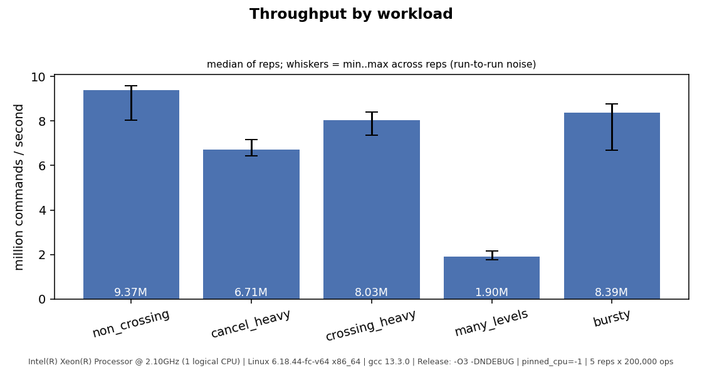
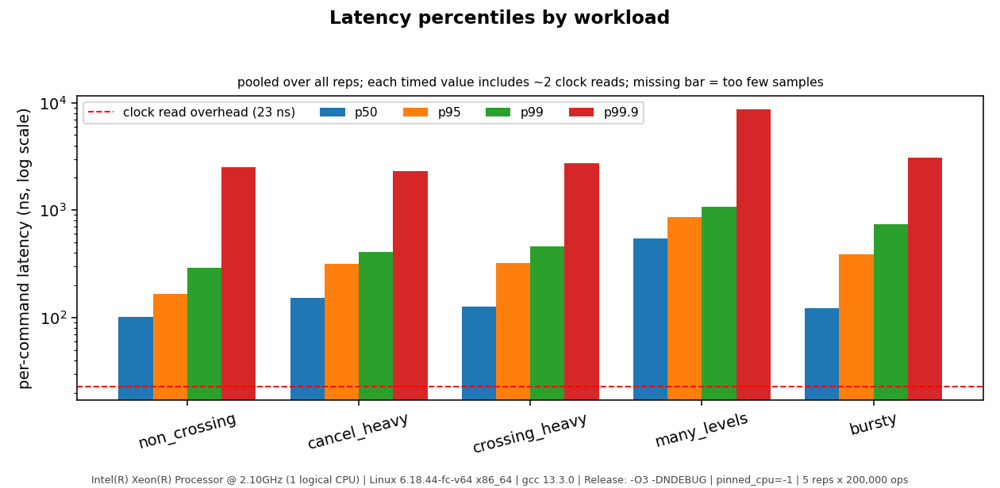
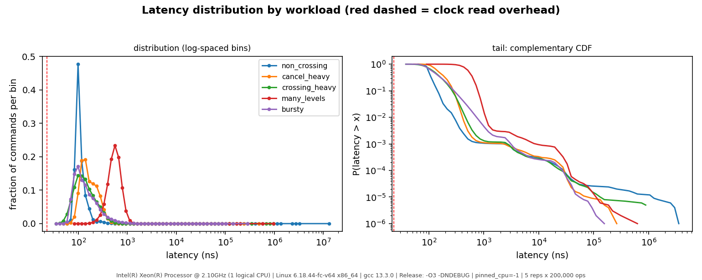
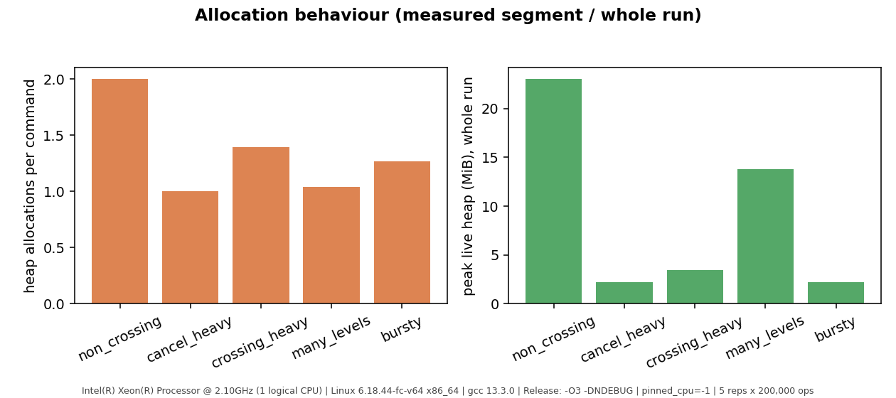

# Baseline results (Phase 4)

> **Read this first.** These numbers come from a shared, single-vCPU cloud VM with no
> frequency control and no CPU pinning (`Intel Xeon @ 2.10GHz`, Linux 6.18, gcc 13.3,
> `-O3 -DNDEBUG`). Treat them as a **demonstration of the measurement tooling and a
> *relative* baseline for this machine**, not as a performance claim. Re-run
> `scripts/run_benchmarks.sh` on your own hardware before quoting anything. Raw data:
> [results/sample_run/](results/sample_run/).

Setup: 5 repetitions x 200,000 measured commands per workload (1,000,000 pooled latency
samples), 20,000 warm-up commands after each workload's prefill, seed 1, clock-read overhead
23 ns (a timed value includes roughly two clock reads).

| workload | ops/s (median) | min..max ops/s | p50 ns | p95 ns | p99 ns | p99.9 ns | allocs/op | trades/op | resting orders at end |
|---|---:|---:|---:|---:|---:|---:|---:|---:|---:|
| non_crossing | 9,374,274 | 8.05M..9.60M | 101 | 166 | 289 | 2,510 | 2.00 | 0.00 | 220,000 |
| cancel_heavy | 6,707,230 | 6.43M..7.17M | 154 | 319 | 409 | 2,301 | 1.00 | 0.00 | 20,096 |
| crossing_heavy | 8,032,087 | 7.36M..8.40M | 127 | 322 | 464 | 2,749 | 1.39 | 0.75 | 31,830 |
| many_levels | 1,902,577 | 1.77M..2.16M | 548 | 866 | 1,071 | 8,613 | 1.04 | 0.00 | 99,682 |
| bursty | 8,387,976 | 6.68M..8.76M | 123 | 388 | 740 | 3,066 | 1.27 | 0.49 | 13,702 |

## How much of this is signal?
Run-to-run spread within a single workload is **11-31%** (min..max across the 5 reps). So
differences smaller than roughly 30% between workloads (e.g. `crossing_heavy` vs `bursty` vs
`non_crossing`) are **not distinguishable** on this machine. Max latencies (up to 12 ms) are
dominated by VM/OS interference and are not reported as findings.

## What the evidence does support
1. **`many_levels` is the outlier: ~4-5x slower per command at the median (548 ns vs 101-154 ns)
   and visibly a separate mode in the distribution plot** - far outside the noise band.
2. **It is not slower because it executes more instructions.** Callgrind counts 582
   instructions/op for `many_levels` versus 846 for `non_crossing`. With callgrind's *simulated*
   cache (32 KiB L1D, 8 MiB LL - an assumed model, not this CPU) `many_levels` takes ~16.2 L1
   read-misses and ~3.0 LL read-misses per op versus ~4.0 and ~1.2 for `non_crossing`. That is
   consistent with memory-latency-bound pointer chasing through `std::map`, `std::list` and hash
   nodes spread over ~100k orders. **Not confirmed with hardware counters** (`perf` is unavailable
   in this sandbox) - confirm with `perf stat -e cache-misses,LLC-load-misses` on real hardware.
3. **Allocation is the largest block of work everywhere.** Callgrind attributes 30-51% of executed
   instructions in the measured segment to the allocator (`malloc`/`free`/`operator new`/`delete`/
   `memset`), see [profile summary](results/profile_callgrind_summary.txt):

   | workload | instr/op | allocator | hash index | engine | book (incl. inlined map/list code) |
   |---|---:|---:|---:|---:|---:|
   | non_crossing | 846 | 50.8% | 14.0% | 11.3% | 21.9% |
   | cancel_heavy | 523 | 32.0% | 12.3% | 16.0% | 36.8% |
   | crossing_heavy | 668 | 35.2% | 12.7% | 18.9% | 25.8% |
   | many_levels | 582 | 29.9% | 11.1% | 14.4% | 40.8% |
   | bursty | 659 | 36.9% | 14.2% | 16.5% | 29.5% |

   Consistent with `allocs/op`: an insert costs 2 allocations (one `std::list` node + one hash-map
   node; level-map nodes are amortised away), a cancel frees 2. Resting orders cost roughly
   **110-170 bytes of live heap each** (`peak_live_bytes / resting orders`) for a 32-byte `Order`.
   (The benchmark's counting `operator new` adds a few percent of instructions to the allocator
   share; the conclusion does not depend on it.)
4. **The `unordered_map` ID index creates deterministic latency spikes while the book grows.**
   In `non_crossing`, ops 20,753 / 42,043 / 85,229 / 172,933 stalled for ~0.1 -> 0.4 -> 1 -> 2 ms
   on **every** repetition (the same indices, roughly doubling - one off-pattern spike in 5 reps
   was noise; reproduce with `lob_spikes non_crossing 100 5`). That is the signature of the table rehashing at each growth step. It affects maximum
   latency, not p99/p99.9 (only 4 samples in 200,000). The index is also 11-14% of instructions.
5. **Cost per command is ~100-150 ns at the median on the simple paths** (including ~2 clock reads,
   i.e. tens of ns of measurement overhead). Nothing here supports any claim about
   exchange-grade or nanosecond latency, and none is made.

## What this does *not* tell you
* The price-level `std::map` shows as only 0-5% self cost because its code is inlined into
  `OrderBook::add_to`/`cancel` (the "book" column). Its real cost is the cache misses visible in
  `many_levels`, not instruction count.
* Workloads are uniform-random synthetic flow. Real order flow clusters at the touch and has
  heavy-tailed sizes; these numbers do not predict behaviour on any real market.
* p99.9 uses 1,000,000 pooled samples (so ~1,000 tail samples) but they come from 5 replays of the
  *same* command list, so they are not 5 independent draws of the workload.
* Single-threaded only; callgrind instruction counts are deterministic but are not time.

## Candidates for Phase 5 (pick exactly one, justify with a before/after on the same workloads)
| Candidate | Evidence from this baseline | Expected effect | Risk |
|---|---|---|---|
| **Allocation churn** (pool / arena for list nodes and hash nodes, or an intrusive order pool) | 30-51% of instructions in the allocator on all five workloads; 1-2 allocs/op | broad throughput gain, flatter tail | custom allocator lifetime bugs; changes memory layout |
| **ID index** (reserve, or flat open-addressing hash) | 11-14% of instructions; reproducible rehash stalls up to ~2 ms | removes growth spikes; faster lookup | cancellation-handle stability must be preserved |
| **Price-level container** (flat/array-indexed levels) | `many_levels` is cache-miss-bound, ~4-5x slower | big win only for wide books; little for books concentrated at the touch | depends on realistic price distribution - needs a more realistic workload first |

Allocation churn has the broadest support so far; the decision is deferred to Phase 5, which must
keep the `std::map` implementation as a selectable baseline for fair comparison.
