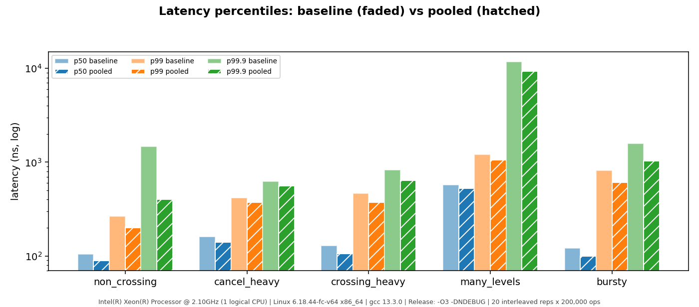
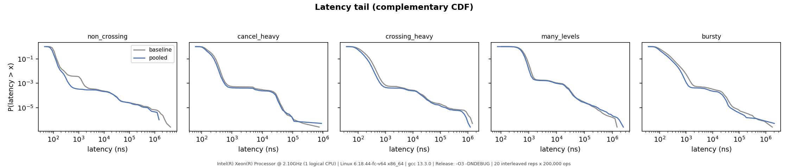
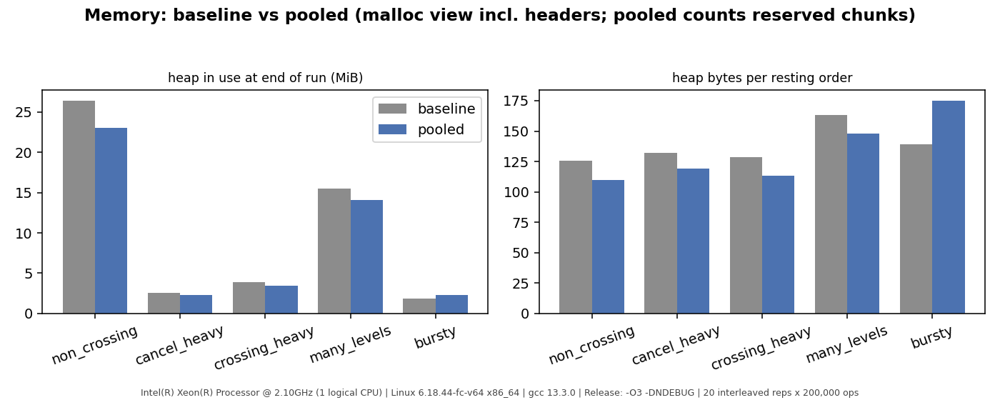

# Phase 5 results: baseline vs pooled engine

> Same caveat as Phase 4: a shared, single-vCPU cloud VM (`Intel Xeon @ 2.10GHz`, Linux 6.18, gcc 13.3,
> `-O3 -DNDEBUG`), no pinning, no frequency control. The **relative** comparison is what matters and it
> is made with the same binary, same machine, same workloads, and **interleaved** repetitions (the engines
> alternate within each repetition and swap who goes first), so slow machine drift cannot favour either.
> Raw data: [results/phase5_run/](results/phase5_run/). Re-run on your hardware before quoting numbers.

Setup: 20 interleaved repetitions x 200,000 measured commands per workload and engine, 20,000 warm-up
commands after each workload's prefill, seed 1. An earlier independent run of the same experiment (10 reps,
before I corrected the memory metric) gave the same picture: ~1.2-1.3x on four workloads, `many_levels` not
clearly different.

## Throughput (paired by repetition)
The comparison statistic is the ratio pooled/baseline *within each repetition*. A workload is called
"faster" only if a sign test on those 20 pairs gives p < 0.01 (0.05 divided by 5 workloads).

| workload | baseline ops/s | pooled ops/s | median ratio | IQR | min..max | pooled faster in | p | verdict |
|---|---:|---:|---:|---:|---:|---:|---:|---|
| non_crossing | 10,303,701 | 13,000,575 | **1.23x** | 1.12..1.30 | 0.87..1.77 | 18/20 | <0.001 | faster |
| cancel_heavy | 6,648,338 | 8,225,416 | **1.23x** | 1.20..1.27 | 0.98..1.39 | 19/20 | <0.001 | faster |
| crossing_heavy | 8,106,524 | 10,399,669 | **1.27x** | 1.23..1.35 | 0.80..1.72 | 18/20 | <0.001 | faster |
| many_levels | 2,082,337 | 2,215,593 | **1.08x** | 0.95..1.16 | 0.82..1.53 | 11/20 | 0.824 | **inconclusive** |
| bursty | 7,792,735 | 9,694,984 | **1.22x** | 1.19..1.35 | 0.82..1.90 | 19/20 | <0.001 | faster |


## Latency (ns, pooled over all repetitions; baseline -> pooled)
| workload | p50 | p95 | p99 | p99.9 |
|---|---:|---:|---:|---:|
| non_crossing | 104 -> 89 | 153 -> 136 | 264 -> 200 | 1,473 -> 401 |
| cancel_heavy | 160 -> 140 | 330 -> 293 | 416 -> 373 | 626 -> 561 |
| crossing_heavy | 129 -> 106 | 324 -> 258 | 464 -> 372 | 826 -> 639 |
| many_levels | 570 -> 526 | 963 -> 848 | 1,208 -> 1,052 | 11,746 -> 9,316 |
| bursty | 121 -> 100 | 413 -> 342 | 816 -> 612 | 1,574 -> 1,035 |

Percentiles are lower across the board, with the largest tail effect on `non_crossing` p99.9 (1.5 us ->
0.4 us). Per-percentile significance was not tested; the percentiles come from pooled samples of
replays of the same command list. Maximum latencies are omitted here: they are dominated by VM/OS
interference (see [raw table](results/compare_table.md)) and moved in both directions.




## Why it got faster (and why only this much)
Callgrind instructions per command in the measured segment
([full output](results/profile_phase5_summary.txt)):

| workload | baseline instr/op | pooled instr/op | change | allocator share base -> pooled |
|---|---:|---:|---:|---:|
| non_crossing | 846 | 457 | -46% | 50.8% -> 5.4% |
| cancel_heavy | 523 | 353 | -32% | 32.0% -> 0.0% |
| crossing_heavy | 668 | 427 | -36% | 35.2% -> 0.6% |
| many_levels | 582 | 404 | -31% | 29.9% -> 0.0% |
| bursty | 659 | 411 | -38% | 36.9% -> 0.0% |

* The mechanism is confirmed: heap allocations per command fall from 1.0-2.0 to ~0
  (`allocs/op` 2.00 -> 0.001 on `non_crossing`; the only remaining ones are one 64 KiB chunk per
  ~1,300 nodes and large bucket arrays). The remaining 5% "allocator" share in `non_crossing` is `memset`
  zeroing the hash bucket array on rehash.
* **Instructions fell 31-46%, but wall-clock throughput rose only 22-27%.** The rest of the time is
  not instruction-bound.
* **`many_levels` gained nothing reliable even though it executes 31% fewer instructions.** Cache
  simulation (assumed 32 KiB L1D / 8 MiB LL, not this CPU) shows pooling barely changes misses:

  | | baseline D1 / LL read-misses per op | pooled |
  |---|---:|---:|
  | non_crossing | 3.94 / 1.23 | 3.62 / 1.15 |
  | many_levels | 16.17 / 3.03 | 15.04 / 2.79 |

  So pooling removes work, not memory stalls; `many_levels` stays dominated by pointer-chasing misses.
  I had speculated that a list node and its hash node, allocated back to back from one chunk, might
  share cache lines; **the data does not support a locality benefit**. Not confirmed with hardware
  counters (no `perf` here).

## Memory
| workload | heap in use at end (MiB) | bytes per resting order | **heap in use after draining the book (MiB)** |
|---|---:|---:|---:|
| non_crossing | 26.4 -> 23.1 | 126 -> 110 | **2.87 -> 23.06** |
| cancel_heavy | 2.5 -> 2.3 | 132 -> 119 | **0.35 -> 2.28** |
| crossing_heavy | 3.9 -> 3.4 | 129 -> 114 | **0.51 -> 3.45** |
| many_levels | 15.5 -> 14.1 | 163 -> 148 | **1.51 -> 14.07** |
| bursty | 1.8 -> 2.3 | 139 -> **175** | **0.35 -> 2.28** |

(`mallinfo2`, i.e. including malloc headers and rounding; baseline -> pooled.) On the four steadier
workloads pooled uses 9-13% less per resting order. **On `bursty` it uses 26% more**, and after the book
is drained the pooled engine keeps its entire high-water mark while the baseline gives nearly everything
back. That is the price of never returning memory; see [phase5_design.md](phase5_design.md).



## What this did not change
**Rehash stalls are untouched.** `lob_spikes non_crossing 100 3 200000 <engine>` shows the same
latency spikes at the same command indices on both engines (20,753 / 42,043 / 85,229 / 172,933,
growing from ~0.2 ms to ~3.5 ms): rehashing relinks existing nodes and does not allocate them.

## Verdict
For a long-lived engine with steady book depth, node pooling is a **measured, repeatable win of about
1.2-1.3x throughput** and lower p50-p99.9 latency on four of five workloads, at the cost of memory that is
never returned and sanitizer blind spots. It gives **no reliable benefit for wide, cache-miss-bound
books** and can cost more memory on bursty flow. The default engine remains the baseline; promoting
the pooled engine is a one-line alias change that should wait for the Phase 6 review.

## Limitations
* One shared VM, no pinning; per-rep ratios ranged 0.8-1.9, so conclusions rest on paired medians and
  sign tests, not on any single run.
* Synthetic uniform-random flow; `many_levels`'s verdict may change with a realistic price distribution.
* Callgrind instruction counts and simulated misses are not time; no hardware counters were available.
* Only `lob_bench`'s single-threaded engine; no `std::pmr` comparison was run.
* The counting `operator new` in `lob_bench` adds a few percent of instructions to the baseline's allocator share.

## Reproduce
```bash
scripts/run_benchmarks.sh bench_out --pin-cpu 2 --reps 20       # both engines, interleaved
python3 scripts/compare_engines.py bench_out                     # paired ratios, sign tests, plots
scripts/profile.sh non_crossing 100000 baseline && scripts/profile.sh non_crossing 100000 pooled
```
